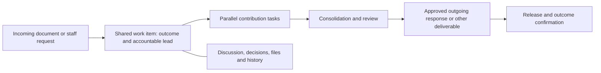

# Office Connect: collaborative work management proposal

**Prepared:** October 16, 2026 (Asia/Manila).

**Status:** Research and implementation proposal; no application changes or launch approval.

**Code reviewed:** `ab50e561a0fc039307fa205ba709291f001717d8`.

**Relationship to the existing plan:** Extends `DOCUMENT_MANAGEMENT_PLAN.md`. Its accepted numbering, authority, verification, signing, release, visibility, and bureau-wide trial requirements remain requirements unless explicitly revised. The proposal below is not a claim that the documented live integration gates have passed.

## 1. Recommendation

Make **Work** the place where staff coordinate an outcome. Keep **Documents** as the official incoming/outgoing register and evidence attached to that work.

A shared work item, initially called a **case** in the implementation, should answer:

1. What outcome do we owe, to whom, and by when?
2. Who is accountable, and what does each contributor need to deliver?
3. What is waiting on another person, information, or a decision?
4. Which discussion, draft, and decision are current?
5. What evidence proves the work is complete?

Use plain names in the interface: **My work**, **Team work**, **Requests and projects**, **Inbox**, and **Documents**. Test whether staff prefer “request,” “work item,” or “case” before fixing the top-level label. Do not require users to learn all three names.

Keep Office Connect's directory, authority rules, calendars, approvals, and Google Workspace investment. Build the collaboration layer within the existing application, and continue using Google Docs/Sheets for simultaneous content editing. Borrow product patterns from the platforms below; do not introduce an entirely separate task system with duplicate accounts and competing status fields.

## 2. What the current implementation does well—and where it falls short

This is a repository review, not an audit of the live deployment or a usability study with staff.

| Evidence in the current code | Implication |
|---|---|
| `documents_storage.py` has assignments, directives, versions, reviews, signatures, dispatches, notices, and append-only events. | Retain the formal record and accountability foundation. The feature is already more capable than a spreadsheet register. |
| `templates/documents/index.html` lists number, subject, verification, workflow, date, and lead. | It tells users about records, but gives little help answering “what must I do next?” |
| `documents.list_visible(..., queue='mine')` selects open documents the user can work on. `documents_notify.home_task` returns an aggregate document count. | “My actions” is not yet a precise list of the person's outstanding contributions or decisions. Broad authority can also make the queue larger than their actual workload. |
| `templates/documents/detail.html` combines assignments, files, directives, many action forms, service operations, and an audit timeline. | Routine collaboration has to compete with record administration and exceptional recovery actions. |
| Some forms ask for account IDs, assignment numbers, document IDs, and source fingerprints. The timeline exposes actor IDs and JSON evidence. | Replace these with people pickers, contextual actions, linked records, readable history, and an advanced details view. |
| Assignment progress is stored as a status and outcome; there is no dedicated case/task discussion, watcher, dependency, or blocker model in the reviewed Documents schema. | Staff can record progress, but cannot easily ask for help, resolve a thread, explain a dependency, or follow work together. |
| Assigning contributors is an officer action; there is no general work planning space for a lead. | Leads need a way to propose a work plan and coordinate execution while chiefs retain assignment authority where policy requires it. |
| Incoming/outgoing links exist, but each document remains a separate workflow record. | A matter involving several incoming letters, division inputs, and one consolidated response has no single shared outcome view. |

The existing setup document explicitly leaves policy acceptance and live Drive/OCR/signing/mail checks open. A redesigned interface does not resolve those dependencies by itself.

## 3. What other platforms suggest

These findings come from first-party documentation and repository source retrieved on October 16, 2026. Features and commercial edition availability should be checked again before procuring or adopting a product. This was not a live trial of these products.

| Platform | Verified pattern | Apply it to Office Connect |
|---|---|---|
| **Asana** [S1] | Its task model has an assignee, followers, parent task, dependencies/dependents, project memberships, and comment/activity records. | One accountable owner per task, collaborators who can follow it, explicit dependencies, and the same task appearing in several useful team views without copying it. |
| **Microsoft Planner** [S2] | Tasks belong to plans/buckets and expose assignments, checklist details, external references, and a conversation thread reference. | Simple task cards with people, due date, checklist, discussion, and linked working files. Do not assume every Planner edition has the same advanced features. |
| **OpenProject** [S3] | Work packages represent tasks and other work types, with assignee/status/priority/dates, configurable views, hierarchies, and relations such as blocks/blocked-by. | The strongest reference for formal cross-unit work: a clear outcome hierarchy, responsibility, dependencies, and shared views. |
| **Plane** [S4] | Work items, shared filtered views, modules, and pages; its source defines parent items, comments, assignees, and blocking relations. | A cleaner daily work experience, with discussion and context close to execution. Bureau staff do not need software-development terminology or mandatory sprint cycles. |
| **GitHub Projects** [S5] | Table, board, and roadmap are views over referenced issues/PRs; changes stay synchronized. It also supports custom fields, templates, automation, and status updates. | One authoritative work item across My work, Team work, and project views. The board must not become a second database maintained by hand. |
| **Docmost** [S6] | Collaborative editing, spaces, permissions/groups, comments, page history, and search. | Shared context and institutional knowledge: working briefs, decisions, and reusable lessons alongside tasks. Google Docs can provide the editing capability initially. |
| **Paperless-ngx** [S7] | Document ingestion/OCR, metadata, search, object permissions, and triggered workflows. | Improve intake, classification, and retrieval. Its document-management strengths address a different part of the problem from day-to-day task coordination. |
| **Vikunja** [S8] | Its task relation implementation includes parent/subtask, related, blocking/blocked, and follows/precedes relationships. | Explicit relationships are more useful than a free-text “waiting” note. Start with a small, understandable subset. |

**Design choice:** combine simple tasks and ownership from Asana/Planner, structured cross-unit coordination from OpenProject, shared views from Plane/GitHub Projects, and contextual discussion from Docmost. Preserve the registry strengths already present in Office Connect.

Direct access to several vendor websites and GitHub's hosted documentation site returned `403 Forbidden` in this environment. The comparisons above use successfully retrieved first-party material on GitHub instead. Basecamp was considered, but its page could not be retrieved and is not used as evidence. Repository READMEs describe intended capabilities; inspected schema/model code supports only the specific observations cited here.

## 4. The proposed work model

### A. One shared outcome, multiple records

A case has a title, expected outcome, accountable lead, concerned units, priority, external due date when applicable, and a work plan. Several incoming and outgoing documents can belong to the same case. An outgoing document can also start a case without an incoming letter. A meeting action or internal request can start work without inventing an incoming/outgoing registry number.

Registration asks **“Does this require action?”** and **“Start new work or link to existing work?”** A reference-only document can remain in the register without creating an artificial task. Similar subjects may suggest a link but cannot silently merge matters.

Keep permanent IN/OUT numbering and official document states. A work item's internal identifier does not replace the correspondence number. Where a document is relevant to several cases, nominate one case responsible for its preparation/release; other links are references, so multiple leads cannot independently dispatch the same reply.

### B. Tasks with accountable owners and explicit deliverables

Each task has a verb-led title, one responsible person, supporting collaborators, expected output, internal deadline, and acceptance criteria. Units may receive proposals, but an unresolved unit assignment remains visible until a person accepts responsibility.

Start with **To do → In progress → For review → Done**. Keep **Blocked** and **Waiting for someone** as visible conditions with a reason, responsible follow-up person, and follow-up date. An external wait does not pause the official deadline. A returned contribution goes back to In progress with the review note retained.

Use simple dependencies: “needs this task completed first” and “related to.” Detect cycles. Show a late upstream contribution's effect on consolidation and approval buffers. Do not silently move external deadlines or infer authorization from a board drag.

Leads can draft a plan, propose tasks, discuss work, and request contributions. Confirming assignments or changing official deadlines follows the existing chief/officer authority policy. Broader delegated task authority is an explicit policy decision, not a side effect of redesigning the screen.

### C. Discussion that produces action

Add case and task threads, replies, permitted-user mentions, follow/unfollow, and unread indicators. Staff can ask a question, post a draft, explain a blocker, request help, or submit a contribution in context.

Provide **Create task from this message** and **Record decision** actions. The source message remains linked. A formal directive or approval still requires its dedicated authorized action; a casual comment, reaction, read receipt, or mention does not count as approval or acknowledgment.

Comments may be corrected with visible edit history. Decisions preserve who made them, when, and the reason. A changed instruction records which tasks and draft approvals need reconsideration while preserving submitted work. Keep discussion separate from the immutable technical audit trail.

### D. Collaborative files and controlled final versions

Show one clearly labeled working draft with an **Open in Google Docs/Sheets** action and named supporting files. Colleagues coauthor there, and coordinate handoffs in Office Connect. Office Connect retains version references, decisions, and release evidence.

The revision sent for approval must still be identified exactly. Changes to the approved artifact follow existing invalidation/signing rules. Adding a comment or changing a follower must not invalidate an approved document. App membership and Drive access remain separate; file access problems need a clear request-access route.

## 5. The screens people should use

| Screen | Main question | Suggested content |
|---|---|---|
| **My work** | What do I need to do next? | My contribution tasks, reviews awaiting my decision, approaching dates, blockers I can resolve, and unread replies. Each row shows its specific next action. |
| **Team work** | How can we finish together? | List/board of the same tasks, grouped by outcome, unit, assignee, or stage; unassigned work, blockers, due dates, and handoff requests. |
| **Work item** | What is happening on this request? | Outcome, lead, deadline, next milestone, then **Overview / Tasks / Discussion / Files / Decisions / History**. Retain selections on return. |
| **Review inbox** | What decision is waiting for me? | Exact draft, requested decision, prior reviewer notes, required evidence, and Approve/Return actions. Link into the existing approvals area. |
| **Documents** | What was officially received or sent? | Incoming/outgoing register, verification, permanent numbers, receipts, dispatches, related work, and search/export. |
| **Manager overview** | Where does the team need support? | Unassigned tasks, overdue handoffs, time waiting for review, blocked work, and outcomes at risk. Click any metric to see the underlying authorized items. |

On the work item page, show one prominent next action appropriate to the viewer. Put cancellation, duplicate merging, access administration, and service reconciliation under appropriate menus or administrator views. Display names and units, not raw numeric IDs. Use a compact task drawer for ordinary updates; retain a full page on small screens and for deep links.

Deliver the list and contextual actions first. Add the board as an alternate view over the same task service. Drag-and-drop must have accessible button/keyboard equivalents and obey the same transition rules.

### Make intake and setup easier

Offer a short intake flow: attach a Drive source or enter the basic details, review extracted suggestions when available, choose the required outcome, then start or link work. The current form makes users register before requesting extraction; the proposed flow should support reviewing suggestions before registration while assigning the permanent number only at the existing registration step. Missing scans must still be supported.

Begin with a few curated office scenarios: **Prepare a response**, **Provide inputs/data**, **Attend or organize an activity**, and **For information/reference**. Each proposes the relevant deliverables, contribution steps, and review needs. A proposal cannot supply unapproved signing authority, release policy, or a made-up external deadline. Separate these simple user choices from the later administrator-configurable template builder.

Give designated administrators a guided readiness page for people/roles, official policies, working-day coverage, and Google connections. Show a specific next setup action and the capability it unlocks. Staff should see only a relevant explanation when their next formal action is blocked. Keep technical operation IDs and relay diagnostics in administrator details. Reuse directory people/unit pickers throughout setup and access management.

## 6. A representative bureau workflow

**Example:** A letter requests a consolidated technical response from two divisions.

1. Receiving registers the letter and starts or links the shared work item, “Submit consolidated technical response.” Verification and routing retain their current rules; permitted preliminary coordination can start before verification.
2. The responsible officer confirms a lead. The lead proposes two division input tasks, a consolidation task, a review task, and a release task. Authorized officers confirm assignments and deadlines.
3. Both divisions work in parallel. Each sees its deliverable, internal date, other contributions it may read, and the shared working document.
4. A contributor flags “Waiting for regional data,” identifies the follow-up owner, and mentions the lead. The lead sees the effect on consolidation immediately.
5. The lead reviews submitted inputs, requests corrections when necessary, and consolidates an outgoing draft linked to the original letter and the shared work item.
6. The authorized reviewer approves the identified version; the signatory signs; authorized staff release it. These remain distinct actions with evidence.
7. The work item closes only when required contributions are accepted and the relevant release/acknowledgment/closure conditions are satisfied. Sending an email does not automatically prove the intended outcome was achieved.

Also test reference-only receipt, attendance requests tied to Calendar, an outgoing memo initiated internally, a changed Director directive, a reassignment to an OIC, and a restricted case. These prevent the design from assuming every incoming document needs one outgoing reply.

## 7. Participation and notification rules

**Participation:** One accountable lead per case; one responsible owner per task; collaborators can contribute without becoming co-owners; followers receive updates without acquiring authority. Existing chief/OIC and records/signatory roles govern formal actions.

**Visibility:** Case/task membership, document access, and Drive access are separate checks. A mention, dependency, team board, search result, notification, or membership change must never grant document access. Initially use one audience for a case and its tasks/discussions. Default cases containing restricted material to an appropriately restricted audience; resolve incompatible audiences explicitly before linking. Avoid per-comment confidentiality settings in the first release. Do not leak hidden titles or counts through relations or summaries.

**Notifications:** Send immediate alerts for a new assignment, a reply/mention directed at the user, review requests, changed decisions that affect their work, and urgent deadlines. Use digests for routine follower activity. Deduplicate and recheck access at delivery time. Keep notification reads separate from formal acknowledgment. A manager's broad visibility should not subscribe them to every minor edit.

**Progress:** Show task counts and named outstanding deliverables. If a percentage is displayed, label exactly what it measures; three easy tasks and one critical review do not imply the case is safely 75% complete. Do not rank staff productivity by raw task closure counts.

## 8. Implementation approach and migration

Retain FastAPI/Jinja and SQLite initially. The reviewed register volume does not establish a need for a rewrite, new database, or custom collaborative editor. Introduce small shared work services so Calendar and other office modules can later reference the same tasks.

Proposed entities:

- `work_case`: outcome, accountable lead, unit scope, priority, external date, stage, access policy, revision.
- `work_task`: case, owner, expected output, internal date, state, acceptance requirements, blocker information, revision.
- `work_task_relation`: dependency or related task, with cycle validation and access checks.
- `work_member`: case participants/followers and their explicit collaboration roles.
- `work_comment` / comment revisions / mentions: discussion, replies, edit history, unread cursor.
- `work_decision`: decision, authority, affected tasks, document/version references, and supersession history.
- `work_document`: case/document relationship and primary preparation/release responsibility.
- `work_event` and delivery intents: readable activity plus durable, permission-checked notifications.

Treat this as a proposed domain contract, not final SQL. Specify invariants and query patterns before implementing tables.

Keep `document`, file versions, approvals, signatures, dispatches, and original audit events authoritative for official records. Choose one authoritative store for task progress: do not let `document_assignment` and `work_task` diverge. Migrate contributor assignments with source-ID mappings; map lead assignments to case ownership rather than inventing redundant tasks. Keep historical attribution and unresolved states. Backfill similar-looking documents into cases only after an officer confirms grouping.

After cutover, compatibility routes must invoke the same task service; legacy assignment rows become preserved history or a derived view, not a second writable workflow. Migrate on a copy first, reconcile counts/owners/states, and retain a pre-cutover backup. After new tasks/discussions exist, recovery must preserve that work; a blind rollback to the old database would lose it.

Give tasks their own revisions and append comments independently so two contributors can work without continuously making each other's document forms stale. Use paginated queries and batched access checks for queues; the current full-register scan and per-record lookups should not be expanded into every task view. Measure realistic list latency and concurrent writes before considering PostgreSQL.

Likely integration points: `documents.py`, `documents_storage.py`, `documents_permissions.py`, `documents_routes.py`, `documents_notify.py`, `office_connect.home_tasks`, shared approvals/search, Calendar, and new `work_*` services/templates. Keep the signed-version and dispatch services behind their existing contracts.

## 9. Phases, numbered increments, and acceptance gates

Delivery is explicitly phased and incremental. A **phase** delivers a usable capability; an **increment** is a small, independently reviewable change with its own dependencies and acceptance evidence. These are not promised calendar dates. Estimate each increment after representative workflows, policy choices, and staffing are confirmed.

| Stage | Deliverable | Exit evidence |
|---|---|---|
| **P0 — Agree the working model** | Walk through the scenarios above with receiving staff, contributors, a lead/chief, and a reviewer; map current vs proposed steps; produce clickable sample screens and define authority/visibility rules. | Users can identify their next action, responsible person, and expected outcome; case terminology and delegation policy are recorded. Reconcile open D0 decisions rather than assuming them resolved. |
| **P1 — Make individual work actionable** | Shared case/task foundation, linked documents, My work, simplified intake with curated scenarios, guided readiness, contextual contribution submission/review, and a readable work item page. Preserve the register. | A two-division request produces independent tasks and one consolidated outcome; My work shows actual responsibilities, and reference-only records produce no artificial workload. |
| **P2 — Make collaboration useful** | Threads/replies/mentions, followers/unread state, blockers, simple dependencies, and handoff/decision history. | Contributors can resolve a question and a blocked dependency without a separate status-chasing conversation; access revocation removes all relevant visibility and future notices. |
| **P3 — Connect team execution and formal release** | Team list/board, multi-input consolidation, version-specific review, notification preferences/digests, and explicit completion gates. | Board and detail changes stay consistent; returned drafts preserve feedback; a changed directive identifies affected work; no transition can bypass approval/signing/release rules. |
| **P4 — Validate and introduce bureau-wide** | Complete live integration acceptance, migrate agreed active records, train each role, publish guidance, and run the previously agreed bureau-wide trial. | Representative users complete both incoming and outgoing scenarios; migration reconciles; recovery is rehearsed; a named owner monitors support and outcomes during the trial. |
| **P5 — Extend after adoption evidence** | Reusable work templates, meeting actions, project/initiative grouping, calendar-linked milestones, and cross-module work summaries. Add assisted summaries/routing only with source attribution and human confirmation. | Staff use the shared work layer for outcomes beyond correspondence; each new source reuses the same task identity and permission rules. |

### 9.1 Increment delivery rules

- Increments start **Pending**; the tables record their current status. Move an increment through **In progress → In review → Accepted**, or mark it **Blocked** with the specific missing prerequisite. Do not mark implementation complete merely because its plan or code merged.
- Aim for one focused PR per implementation increment. If an increment becomes too large, split it into suffixed IDs such as `P2.1a` and `P2.1b`, each with its own deliverable and acceptance check. Preserve the parent requirement and gate.
- Each implementation increment includes the minimum storage/service/UI changes needed for its stated behavior, relevant tests, and updated operating instructions. Avoid a large backend-only delivery followed by a large UI-only delivery with no demonstrable workflow between them.
- Record the responsible owner, actual dependencies, PR/commit, acceptance evidence, remaining limitations, and recovery approach against the increment. Attach screenshots or a short walkthrough when behavior changes visually.
- Keep incomplete capabilities behind appropriate rollout controls. Access checks, audit evidence, and protection of existing records belong in the increment that introduces the behavior; they are not deferred hardening work.
- Check the existing version convention before every user-visible push: bump `APP_VERSION` and add the matching plain-language changelog entry. Planning-only edits do not need an application version bump.
- Review the phase's complete workflow after its increments pass. A phase gate requires the outcomes in the phase table above, not just a count of completed PRs. Later implementation can proceed only when its listed dependencies are accepted; bureau-wide activation waits for P4.
- Preserve accepted D0–D13 obligations from the original Documents plan. Reference the applicable original requirements in each implementation PR, especially authority, visibility, deadlines, approvals, signing, dispatch, and closure.

### 9.2 P0 — Agree the working model

**Progress, October 16, 2026:** P0.1–P0.3 proposals and local checks are ready for review. See the [Phase 0 evidence and authority contract](WORK_MANAGEMENT_PHASE0.md) and [interactive walkthrough](prototypes/work-management.html). Staff validation and live deployment verification remain open; the P0 gate is not yet accepted.

| Increment | Status | Depends on | Small deliverable | Acceptance evidence |
|---|---|---|---|---|
| **P0.1 — Current workflow and baseline** | In review | None | Walk through receipt, parallel inputs, internal outgoing work, reference-only records, and restricted work with representative roles. Record baseline effort and actual deployment/integration status. | A documented journey for each scenario; unresolved policy and live integration requirements have named owners. |
| **P0.2 — Domain and authority contract** | In review | P0.1 | Agree case/task terminology, ownership, task transitions, audiences, and task/document authority boundaries. Define the single authoritative task store and migration mapping. | Examples cover cross-unit participation, OIC reassignment, restricted material, and a changed directive without contradictory authority or duplicate task states. |
| **P0.3 — Screen walkthrough** | In review | P0.2 | Produce clickable sample My work, work item, contribution, and review screens. | Contributors and reviewers can identify their next action, owner, draft, and expected outcome; record corrections before implementation. |

### 9.3 P1 — Make individual work actionable

**Progress, October 16, 2026:** The user's instruction to continue authorizes development of P1.1 against the proposed P0 contract. P1.1 was merged into main at `e4c5da2` on the user’s instruction, with writes disabled by default; this development exception does not record staff acceptance of P0 or authorize operational rollout. See [P1.1 implementation and verification](WORK_MANAGEMENT_P1_1.md). P0 validation remains open. The user also authorized the next increment: [P1.2 implementation and verification](WORK_MANAGEMENT_P1_2.md) was merged at `aeba93e`, with contribution creation through acceptance locally verified. The next authorized increment, [P1.3 compatibility and rehearsal](WORK_MANAGEMENT_P1_3.md), was merged at `027d76b`. [P1.4 personal work and home integration](WORK_MANAGEMENT_P1_4.md) was merged at `53f1fb4`, preserving newer main fixes, with packaging corrected at `ff100fe`. [P1.5 guided intake](WORK_MANAGEMENT_P1_5.md) was merged at `7249534`. [P1.6 contextual work screens](WORK_MANAGEMENT_P1_6.md) was merged at `77d9611`. [P1.7 guided administrator readiness](WORK_MANAGEMENT_P1_7.md) was merged at `17dc12f` as version 6.59. The user explicitly accepted Phase 1 and authorized the next increment on October 16, 2026. Phase 1 acceptance does not claim live integration verification or supersede the P4 rollout checks.

| Increment | Status | Depends on | Small deliverable | Acceptance evidence |
|---|---|---|---|---|
| **P1.1 — Shared work item and document links** | Accepted | P0 gate; development exception above | Create/read a shared work item with an accountable lead and permission-checked links to existing IN/OUT records. | Multiple records can support one outcome; linking does not change document numbers or grant restricted access. |
| **P1.2 — Contribution task lifecycle** | Accepted | P1.1 | Create/propose, confirm, acknowledge, submit, return, and accept a contribution task with owner, output, and internal date. | Two contributors can progress independently; only the authorized person accepts work or confirms assignments; revisions reject stale conflicting updates. |
| **P1.3 — Assignment compatibility and migration rehearsal** | Accepted | P1.2 | Map legacy assignments on a copy, preserve source IDs/history, and route enabled compatibility writes through the same task service. | Owners, states, and mandatory contributions reconcile; lead rows become ownership rather than duplicate tasks; repeat migration does not duplicate work. |
| **P1.4 — My work and home integration** | Accepted | P1.3 | Show each person's specific outstanding tasks with the next action, due date, and linked work item. | Completed tasks disappear from actionable work; broad officer visibility does not become a list of personal obligations; pagination and access checks hold. |
| **P1.5 — Simplified intake and curated scenarios** | Accepted | P1.1–P1.3 | Support new/existing work selection and the initial office scenarios; allow review of extraction suggestions before registration. | Reference-only intake creates no unnecessary task; failed extraction leaves manual entry usable; numbering occurs at registration under existing rules. |
| **P1.6 — Contextual work item interface** | Accepted | P1.4, P1.5 | Replace raw-ID contribution forms with task actions, people pickers, readable history, and a clear next action. | Staff complete the two-division contribution journey on desktop and narrow screens without entering database IDs. |
| **P1.7 — Guided administrator readiness** | Accepted | P0.2, P1.1 | Present role, policy, holiday, and integration readiness with precise next setup actions. | Each unmet prerequisite explains what it blocks; setup never invents signing authority or enables dispatch inadvertently. |

### 9.4 P2 — Make collaboration useful

**Progress, October 16, 2026:** Following explicit user acceptance of Phase 1, [P2.1 discussion and replies](WORK_MANAGEMENT_P2_1.md) was merged at `9622870` as version 6.60 on the user’s instruction. [P2.2 mentions, following and unread state](WORK_MANAGEMENT_P2_2.md) was merged at `4a44fc0` as version 6.61 on the user’s instruction. [P2.3 blockers and dependencies](WORK_MANAGEMENT_P2_3.md) was merged at `d44d868` as version 6.64, preserving intervening Google Meet releases on main. [P2.4 discussion-derived tasks and decisions](WORK_MANAGEMENT_P2_4.md) was merged at `855b7bb` as version 6.65 on the user’s instruction. [P2.5 collaborative draft handoff](WORK_MANAGEMENT_P2_5.md) was merged at `0dbfdb8` as version 6.69, preserving intervening main releases. The [Phase 2 acceptance review](WORK_MANAGEMENT_PHASE_2_ACCEPTANCE.md) passes technical criteria with 240 passing tests and recommends acceptance. The user authorized P3.1 after this recommendation, accepting the Phase 2 gate. Live and operational verification remains in Phase 4.

| Increment | Status | Depends on | Small deliverable | Acceptance evidence |
|---|---|---|---|---|
| **P2.1 — Discussion and replies** | Accepted | P1 gate | Add case/task threads, replies, and visible edit history. | Two contributors can discuss a task; posting a comment does not invalidate a draft approval or make an unrelated task update stale. |
| **P2.2 — Mentions, followers, and unread state** | Accepted | P2.1 | Add permission-aware mentions, follow/unfollow, unread markers, and durable targeted notices. | Mentions never grant access; duplicate alerts are suppressed; revocation prevents subsequent reads and deliveries. |
| **P2.3 — Blockers and dependencies** | Accepted | P1.2, P2.2 | Add a blocker reason, follow-up owner/date, and task dependency links. | Dependency cycles are rejected; upstream delays are visible; waiting does not silently extend an official deadline. |
| **P2.4 — Turn discussion into tasks and decisions** | Accepted | P2.1, P2.3 | Create a proposed task from a message and record an authorized decision with its source and affected work. | The original discussion remains linked; informal comments cannot become formal approval; changed directives preserve prior contributions and identify reconciliation needs. |
| **P2.5 — Collaborative draft handoff** | Accepted | P2.4 | Identify the working Google draft, supporting files, and contribution handoff notes within the work item. | Participants can identify the current draft and open it when Drive access permits; app access is not presented as proof of Drive access. |

### 9.5 P3 — Connect team execution and formal release

**Progress, October 16, 2026:** Following user acceptance of the Phase 2 gate by authorizing P3.1, [shared team list and board views](WORK_MANAGEMENT_P3_1.md) are implemented for review as version 6.70.

| Increment | Status | Depends on | Small deliverable | Acceptance evidence |
|---|---|---|---|---|
| **P3.1 — Shared team views** | In review | P2 gate | Add team filters and list/board views over the existing task service. | Updating a task in either view updates My work and its detail page; unauthorized transitions are rejected; equivalent keyboard actions exist. |
| **P3.2 — Consolidation and review inbox** | Pending | P2.5, P3.1 | Surface accepted/missing inputs, the exact outgoing draft, and requested reviews in the existing approvals experience. | The reviewer can approve or return the identified version with retained feedback; a changed source cannot retain an invalid approval. |
| **P3.3 — Formal release and case completion** | Pending | P3.2 | Connect existing signing/dispatch evidence and mandatory-contribution checks to the shared outcome. | Case completion cannot bypass required contributions, release, acknowledgment, or closure evidence; an uncertain send cannot trigger an unconditional resend. |
| **P3.4 — Notification preferences and digests** | Pending | P2.2, P3.3 | Separate actionable alerts from routine follower updates and provide digest preferences. | Urgent required notices remain actionable; digests avoid duplicates and omit items the recipient can no longer access. |
| **P3.5 — Manager support overview** | Pending | P3.3, P3.4 | Show unassigned work, blocked tasks, review waits, and outcomes at risk using defined metrics. | Each metric links to matching authorized records; missing dates are distinct from overdue work; case/task/document counts are not conflated. |

### 9.6 P4 — Validate and introduce bureau-wide

| Increment | Status | Depends on | Small deliverable | Acceptance evidence |
|---|---|---|---|---|
| **P4.1 — Whole-workflow and live integration acceptance** | Pending | P3 gate; required policy/configuration available | Run the representative multi-user journeys and complete the original Documents live Drive/OCR/signing/mail gates. | Both incoming and outgoing paths work with authorized acceptance recipients and files; evidence identifies failures, skipped checks, and actual outcomes. |
| **P4.2 — Active-record cutover and recovery rehearsal** | Pending | P4.1, P1.3 | Rehearse migration of agreed active records, reconcile results, and exercise recovery preserving new collaboration data. | Record/task counts, owners, dates, restrictions, and history reconcile; no dual writable task store remains; recovery does not discard new work. |
| **P4.3 — Role guidance and bureau-wide trial** | Pending | P4.2 | Prepare role-specific guidance, name support owners, and introduce the agreed trial. | Receiving staff, contributors, leads, and reviewers can each complete their responsibilities; trial issues are captured with owners and priorities. |
| **P4.4 — Trial evaluation and stabilization** | Pending | P4.3 | Compare results with P0 baselines and agreed targets; resolve release-blocking usability and workflow issues. | Record achieved targets, remaining limits, and the operational acceptance decision before broadening scope. |

### 9.7 P5 — Extend after adoption evidence

| Increment | Status | Depends on | Small deliverable | Acceptance evidence |
|---|---|---|---|---|
| **P5.1 — Reusable work templates** | Pending | P4 gate | Let authorized administrators version reusable task/role/milestone templates based on successful trial workflows. | New work inherits the selected version; template edits do not silently change active assignments or authority. |
| **P5.2 — Meeting actions and calendar milestones** | Pending | P5.1 | Create/link tasks from meeting decisions and connect confirmed milestones to Calendar. | The action has one task identity and owner across views; calendar audiences do not expose restricted work. |
| **P5.3 — Projects and broader office work** | Pending | P5.2 | Group related work items under initiatives and expose useful cross-module summaries. | Shared views preserve source permissions and authority; users do not maintain duplicate progress records. |

Assisted summaries or routing can be proposed as additional numbered increments after P5 adoption evidence. They are not required for this delivery sequence and cannot approve, sign, or send on a user's behalf.

### 9.8 Phase gates and release boundary

The default sequence is **P0 gate → P1 gate → P2 gate → P3 gate → P4 gate → P5**. Dependencies in the tables allow independent increments within an eligible phase to proceed without waiting for unrelated work. Any reordered increment must document why its prerequisites are already satisfied.

Each phase review records: a demonstrated scenario, relevant test evidence, permission and data-integrity checks, known limitations, and the next increment. If a required check fails, retain the phase as blocked or in progress and resolve it before declaring the phase accepted.

Incremental implementation can merge behind controlled rollout switches. Its completion is not permission to drop existing first-release requirements for incoming/outgoing, assisted intake, signing, or dispatch. The existing plan calls for a bureau-wide trial; a limited-unit operational pilot would be a separate change to that rollout decision.

Defer a workflow canvas, configurable scripting, built-in chat/video, a custom real-time editor, advanced resource scheduling, and autonomous AI approvals/sending. None is necessary to prove the first collaborative scenario.

## 10. Tests and success measures

Future implementation must cover task ownership and cross-unit authorization; dependency cycles; simultaneous edits; mentions/unread behavior; restricted data across boards/search/counts/notifications; OIC reassignment; review returns; changed directives; exact-version approval; dispatch retry uncertainty; and closure evidence. Run browser journeys as two contributors plus a reviewer, including narrow screens and keyboard operation. Unit tests alone cannot demonstrate a usable collaborative workflow.

Establish a baseline during P0 and agree targets before the trial. Measure:

- Time from receipt to an accountable owner and first substantive action.
- Share of active tasks with a named owner, expected output, and confirmed internal date where required.
- Time blocked, time waiting for review, and the reasons for repeated returns.
- On-time accepted contributions and completion of required outcomes, with missing deadlines reported separately.
- Staff effort locating the current draft, identifying the next action, and asking for status.
- Notification usefulness and the proportion of alerts that require no action.
- Adoption across roles: contributions, discussion, review, and closure performed by the people responsible rather than re-entered by one records clerk.

Use these to improve the process, not to construct individual productivity rankings. Define record, task, and case denominators separately.

## 11. Build, integrate, or replace

| Option | Assessment |
|---|---|
| **Extend Office Connect with shared work services** | Recommended first. Reuses identity, chief/OIC authority, calendar, Google files, and official correspondence controls. Requires disciplined scope and ongoing ownership. |
| **Adopt OpenProject as the main work engine and integrate** | Strong alternative if full project/resource/portfolio management becomes essential or the bureau cannot maintain a custom work engine. First prove account lifecycle, granular visibility, authoritative status, and official release integration in a limited technical evaluation. Integration creates its own maintenance work. |
| **Use Plane or Vikunja alongside Office Connect** | Useful comparison/prototype targets, but production adoption would need reliable task linking, account/access synchronization, and a clearly chosen authoritative system. Manual copying of tasks would undermine the goal. |
| **Add Docmost or Paperless-ngx** | Consider only for a separately established knowledge-management or archive/ingestion need. Neither alone supplies the complete bureau work and correspondence contract. |

Compare workflows and operational burden before choosing packages based on popularity. The reviewed OpenProject README declares GPLv3; Docmost declares AGPLv3 core plus separately licensed enterprise directories; Vikunja declares AGPL licensing with exceptions described in its README. Check the exact version/component/edition before reusing source or adopting paid capabilities. This proposal borrows interaction patterns and does not copy third-party implementation code.

## 12. First-party sources

- **S1 — Asana:** [official OpenAPI specification](https://github.com/Asana/openapi/blob/master/defs/asana_oas.yaml), inspected TaskBase/TaskResponse and Story schemas. Supports the model comparison, not a claim about every current plan's UI entitlement.
- **S2 — Microsoft Planner:** [task resource](https://github.com/microsoftgraph/microsoft-graph-docs-contrib/blob/main/api-reference/v1.0/resources/plannertask.md) and [task details](https://github.com/microsoftgraph/microsoft-graph-docs-contrib/blob/main/api-reference/v1.0/resources/plannertaskdetails.md).
- **S3 — OpenProject:** [repository](https://github.com/opf/openproject), [work packages guide](https://github.com/opf/openproject/blob/dev/docs/user-guide/work-packages/README.md), [relations and hierarchies](https://github.com/opf/openproject/blob/dev/docs/user-guide/work-packages/work-package-relations-hierarchies/README.md), and [views](https://github.com/opf/openproject/blob/dev/docs/user-guide/work-packages/work-package-views/README.md).
- **S4 — Plane:** [repository/README](https://github.com/makeplane/plane) and [work item models](https://github.com/makeplane/plane/blob/preview/apps/api/plane/db/models/issue.py). Development-branch source is evidence of design, not proof that all features ship in every edition.
- **S5 — GitHub Projects:** [official documentation source](https://github.com/github/docs/blob/main/content/issues/planning-and-tracking-with-projects/learning-about-projects/about-projects.md).
- **S6 — Docmost:** [repository/README](https://github.com/docmost/docmost).
- **S7 — Paperless-ngx:** [repository](https://github.com/paperless-ngx/paperless-ngx), [features](https://github.com/paperless-ngx/paperless-ngx/blob/main/docs/index.md), and [usage, permissions, and workflows](https://github.com/paperless-ngx/paperless-ngx/blob/main/docs/usage.md).
- **S8 — Vikunja:** [repository](https://github.com/go-vikunja/vikunja) and [task relation implementation](https://github.com/go-vikunja/vikunja/blob/main/pkg/models/task_relation.go).

Retrieved source copies and fetch results are retained locally in `/workspace/scratch/documents-research/`. Source links reference upstream branches and can change after this review.
