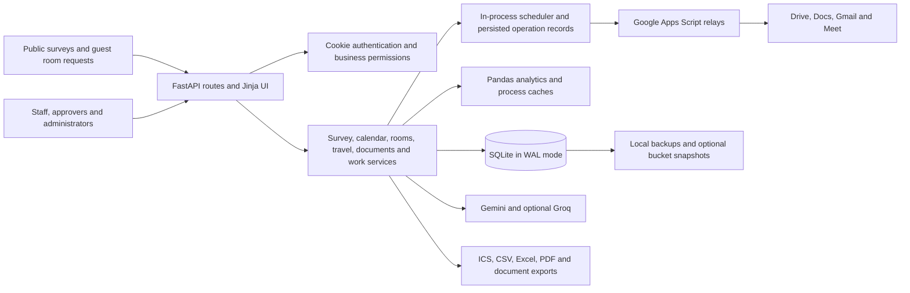

# Office Connect: system audit and incremental improvement plan

Audit date: **19 October 2026**. Source: **Office Connect BLHSD 7.22**, commit `3a45851`. Scope: the repository, a disposable local instance with synthetic data, and current official documentation for peer platforms.

Deliverables: **16 findings, 26 work packages and seven phases**, with evidence, dependencies, preliminary effort ranges and acceptance criteria. Production validation is the first work package.

**The first investment should protect authority and data durability.** Two independently reproduced defects allow staff profile text to change business authority and allow the snapshot loop to miss committed database changes. Existing sessions also outlive important account changes. These are prerequisites for safely expanding integrations and AI access.

The system already contains substantial useful work: office-specific workflows, survey calculations, calendar interoperability, explicit document permissions, approval/version lineage, durable records of external document operations, and thousands of tests. An incremental improvement program can build on these capabilities. A replacement platform or frontend rewrite is not justified by the evidence collected here.

## Read the audit

| Document | Purpose |
|---|---|
| [Findings](FINDINGS.md) | Prioritized defects and improvement opportunities, evidence, consequences, and acceptance criteria |
| [Phased roadmap](ROADMAP.md) | What to deliver first, dependencies, effort ranges, rollout and rollback gates |
| [Current platform benchmarks](BENCHMARKS.md) | Comparisons with OpenProject, Frappe/ERPNext, Microsoft 365, Google Workspace, LimeSurvey, n8n, and a FastAPI reference stack |
| [Evidence and limitations](EVIDENCE.md) | Reproduction methods, test results, browser coverage, measurements, and remaining production checks |
| [Implementation backlog](backlog.csv) | Work packages suitable for importing into an issue tracker |

## Highest-priority findings

| Order | Finding | What was demonstrated | First action |
|---|---|---|---|
| 1 | **F01 — profile-driven privilege escalation** | A directory-linked viewer saved the designation “Director”, gained chief/director authority, and opened another user's previously inaccessible preverification document. Explicitly restricted documents still required explicit access. | Separate self-editable display information from administrator-controlled authority; review existing leadership assignments. |
| 2 | **F02 — persistence change detection is unreliable** | The application's change counter remained `2` across commits while a persistent connection's counter advanced `2 → 3 → 4 → 5`. The snapshot loop can consequently skip later saves and the health view can miss unsaved data. | Correct change detection, prove periodic backup and recovery using real SQLite commits, and verify the deployed persistence configuration. |
| 3 | **F03 — session revocation is incomplete** | A demoted administrator's old cookie still opened user administration; cookies replayed after logout or password replacement were accepted. Deactivated accounts produced a shared-middleware error. | Resolve active status and role from current account state; implement revocable sessions. |
| 4 | **F04/F05/F06 — uneven boundary protection** | Foreign-origin administrative POSTs were accepted when a cookie was supplied; a protocol-relative login return URL redirected externally; repeated failed logins were not throttled. | Apply consistent CSRF/origin, redirect, and authentication-abuse controls. |
| 5 | **F08/F10/F11 — operational reliability** | Known advisories affected the locally installed PDF parser; deployment has no automated test gate; proxy errors can cause the service worker to replay writes. | Verify deployed versions, establish a reproducible release gate, and make write retries safe. |

These findings concern the reviewed code and local reproductions. Production impact depends on the deployed revision, configuration, data, and enabled features. This audit did not establish that an account was abused or that production data was lost.

## System map

The inventory contains **131 top-level Python files**, **81,777 Python lines**, and **182 HTML templates**. `app.py` has 17,074 lines and `storage.py` 11,367. The generated OpenAPI description exposes **411 operations across 362 paths**; none declares a request-body schema or an authentication scheme. Middleware and handlers enforce authentication outside that description. The gap is API contract quality, not proof that all routes are public.

## Part-by-part assessment

The table records inspected components and their next useful change. “Observed” does not mean every possible state or production integration was exercised.

| Part | Existing strengths observed | Main improvement supported by evidence | Roadmap |
|---|---|---|---|
| Identity, profiles and organization authority | Signed cookies, password hashing, capability map, explicit document grants | Fix profile-to-authority escalation and stale sessions; replace title-based authority inference with managed assignments | Phases 0–1 |
| Surveys and registration | Random public tokens, offline submission IDs, consent/retention paths, input-abuse tests | Make statistical calculations safe for missing/invalid values; enlarge survey controls; establish realistic anonymous traffic tests | Phases 1–3 |
| Analytics, official reports and exports | Shared calculation engine, export formats, cached aggregate views | Reproduce and correct NaN/null failures and report narrative defects; verify totals and samples against a maintained synthetic dataset | Phases 1–2 |
| Calendar and presence | Multiple views, recurrence, scope filtering, stable ICS UID/sequence, feed rotation | Protect bearer feed URLs in logs; offer explicit sync status and scope; use a documented integration contract | Phases 1, 3–4 |
| Rooms and meals | Guest/staff flows, approval checks, availability rules, recurring reservations | Harden write retries and request boundaries; fix calendar-dependent test fixtures; test room reservation and meal changes as one user journey | Phases 1–3 |
| Travel | Filing ownership, policy/rate rules, checklists, receipt reading and document generation | Standardize CSRF and integration error handling; move slow work off web requests; verify current policy configuration with its business owner | Phases 1–3 |
| Wellness and work arrangements | Shared approval routing, delegation, personal/team views, official forms | Remove self-editable authority inputs, repair invalid-session behavior, make time-dependent tests deterministic, simplify accessibility defects | Phases 0–3 |
| Documents, intake and OCR | Active-account checks, explicit restricted access, revision conflict detection, exact-version approvals, bounded file handling, FTS search | Preserve these controls while fixing registry query growth, isolating PDF/OCR work, and simplifying the visible workflow | Phases 1–3 |
| Collaborative work | Scoped ownership, explicit confirmation, contribution/review history, bounded page scans | Reduce repeated permission queries; combine document and work actions into a clearer personal queue; publish a small integration API | Phases 2–4 |
| Search and AI | Permission-aware source lookup, deterministic answers, budgets, opt-in modes, fallback, action allowlists | Validate factual claims independently of model confidence; minimize provider data; add evaluations and a scoped external tool boundary | Phases 1, 4–5 |
| Mail and Workspace relays | Signed envelopes, recipient receipts and reconciliation in newer document operations | Apply those guarantees consistently; centralize job retries, timeouts, status and operator alerts | Phases 1–4 |
| Database, caching and persistence | WAL, online backup API, snapshot safeguards, incremental/stale analytics refresh | Repair snapshot detection; remove per-asset database work; retain a single writer until a measured scaling decision is made | Phases 0–2, 6 |
| Deployment and observability | Build/version stamping, backup gate, request metrics, operations screen | Add automated checks before deployment, lock dependencies, correct contradictory runbooks, expose failed jobs and recovery evidence | Phases 0–2 |
| User experience and accessibility | Responsive pages, search, tours, display controls, error/recovery affordances | Repair confirmed accessibility failures; prioritize personal tasks and reduce acronym/technical-language burden | Phases 2–3 |

## Baseline that can be trusted

The full existing suite produced **3,968 passed, 48 failed, 16 skipped** in approximately 210 seconds. The failures include missing snapshot assumptions and calendar-sensitive fixtures as well as reproducible application defects; the suite is not currently a green release gate.

The initial browser review covered 20 desktop/mobile page combinations. Eight targeted follow-up checks examined the affected accessibility surfaces, including additional mobile pages. All sampled page responses were HTTP 200 with no recorded JavaScript exceptions or page-wide horizontal overflow. Automated checks found low contrast, undersized targets, invalid ARIA children, nested interactive controls, and a keyboard-inaccessible scroll region. This is a sample, not WCAG certification or a staff usability study.

On a small synthetic dataset, warm page medians were approximately **10–15 ms** for the main pages measured in-process. Query counts reveal growth risks: **219 SQL statements for Home**, **56 for an authenticated CSS request**, and **2,002 for a 1,000-document registry lookup**. A mocked 300 ms mail delay blocked the event loop for approximately 309 ms. These measurements identify engineering targets; they are not live-site response-time or capacity claims.

## Recommended sequence

1. **Contain authority and durability defects**, then validate the running deployment and recovery path.
2. **Establish consistent security and a trustworthy release process**, including safe retries and dependency control.
3. **Improve the Documents-to-Work journey as the first pilot**, with pagination, responsive jobs and accessibility repairs.
4. **Extend the successful interaction and integration patterns** to rooms, calendar, travel and survey reporting.
5. **Expose small, scoped APIs and evaluated AI capabilities**, using the same permissions and audit rules as the UI.
6. **Choose larger infrastructure changes from measured demand and recovery requirements.** The evidence does not yet establish that a database migration alone would solve the principal problems.

Production validation, representative staff task testing, and the actual traffic/data profile remain required inputs. The supplied login was not used: the live site was inaccessible through the available web tool, and the workspace network policy did not include its domain. No application source, production settings, accounts, or live data were changed.
