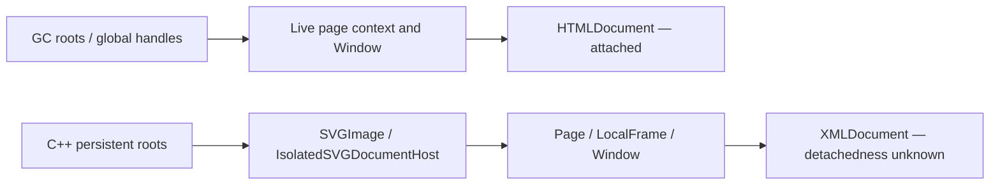

# Authorized forensic snapshots — four captures complete

All four fixed slots completed in original/current/current/original order, with
no exclusions, replacements or extra browser runs. The user explicitly approved
the separate forced-GC diagnostic. Snapshot results remain **outside acceptance**.
Product f700187 is unchanged; **2B and subsequent increments remain blocked**.

The high-document state appeared in current slot 2: 43 documents at navigation
20. It had already fallen to 2 before `HeapProfiler.takeHeapSnapshot` was invoked.
All four post-GC graphs contain the active HTML document and an isolated SVG-image
XML document; no document-like native node is explicitly marked detached. The
transient high-document state therefore was not present in these retaining-path
graphs, and its earlier retaining reference remains unidentified.

## Observations before and after the forensic boundary

The navigation-20 baseline observation occurs before trace shutdown/export.
“Before snapshot” is a new observation after that work, immediately before the
forced-GC API call. Do not attribute the intervening document reduction to the
heap snapshot or treat the observations as simultaneous. JS heap columns are MiB.

| Slot | Source | Nav 20 documents | Before snapshot documents | After snapshot documents | Nav 20 JS heap | Before snapshot JS heap | After snapshot JS heap |
|---|---|---:|---:|---:|---:|---:|---:|
| 0 | Original | 4 | 2 | 2 | 6.053 | 5.413 | 1.403 |
| 1 | Current | 5 | 2 | 2 | 6.459 | 5.388 | 1.408 |
| 2 | Current | 43 | 2 | 2 | 18.327 | 5.411 | 1.408 |
| 3 | Original | 4 | 2 | 2 | 6.104 | 5.386 | 1.397 |

The reduction from 43 to 2 happened without invoking the authorized snapshot
GC yet. It supports transient accumulation in this workload, not a persistent
41-document root surviving at the final snapshot endpoint. Trace shutdown/export
adds time and changes instrumentation activity; this does not establish a precise
collection cause, allocation owner, or correspondence with a prior experiment.
The subsequent JS-heap reduction is a forced-GC observation and cannot pass a gate.

## Retaining paths actually captured

All four graphs have the same two native document categories:



The HTML document path reaches the live page's Window via browser context roots
(`ScriptStateProtectingContext`, `gin::ContextHolder`, or `V8PerContextData`) and
`Window#DocumentCachedAccessor`. These are browser context roots in the captured
path, not evidence that an avatar closure or an inspector object retains old pages.

The XML document path starts at a C++ persistent root labeled
`blink::SVGImage::SVGImage(...)`, through `blink::IsolatedSVGDocumentHost`, a Page,
LocalFrame and C++ Window. The graph identifies the SVG-image host, not a specific
asset URL or avatar component. It is present in both sources. Its detachedness
field is 0 (unknown), so it is not claimed to be explicitly attached.

Each graph also has a JS object named `Document` reached through
`Window.Document.prototype`. This is a prototype object, not a third live document.
The analyzer retains the broad candidate and its path rather than hiding it.
Each graph has three NativeContext-named nodes, not dozens of old page contexts.

All immediate incoming references to document-like nodes are retained alongside
representative root paths. Weak and synthetic shortcut edges are excluded from
path traversal but preserved in incoming-reference records. Internal/hidden edges
and ephemeron semantics require interpretation; this is not a dominator analysis
or an exhaustive proof about every possible retaining path.

## Evidence integrity defect found and recovered

The initial audit correctly failed slot 3's sealed baseline hash. The adapter
saved `False-warm.json` before capture, but the baseline wrote its mutable rows
again after context teardown. Exactly one late response had been appended:
`/telemetry`, status 204, identity encoding. No memory observation or other field
changed. The original post-close artifact is preserved unchanged.

Removing only that trailing response reconstructs the exact pre-snapshot bytes:
SHA-256 `b651124db729997038f8b193e65faf539144d4c9cb64e253a6ef187e7811a90e`.
The post-close version hashes to
`38004af5ed0396b3169a0ffd290a8b232c56138adeef70bd7fdb5e917d440a39`.
The reconstructed file is stored separately under `sealed-recovery/03-original/`.
This is exact-hash recovery of recorded content, not a substituted measurement.

The audit still rejects the original mismatch by default. An explicit recovery
directory is required; recovered bytes must match the preexisting seal, all fields
except the response list must be identical, and the final response list must be
a strict extension of the sealed one. Its status explicitly records
`complete_forensic_capture_with_sealed_recovery`. The first failed audit is retained.

For future runs, adapter v2 freezes nested row data before saving so late events
cannot change the sealed file. A regression executes the actual adapted save/close/
rewrite sequence with a simulated late response; it verifies identical sealed
bytes. The captured experiment used v1 at 6568ac8 and was not rerun after this fix.

## Validation and reproducibility

- Capture source: `6568ac8`; products remain original `1c964dc` and current `f700187`.
- All 86 product/harness/probe hashes and 40 raw evidence files verify.
- All 80 natural navigation observations pass timing/renderer checks; the closed
  natural traces contain no explicit forced-collection flags.
- All four snapshot graphs validate node/edge arrays and counts. Native document
  counts were also recomputed directly from raw graph arrays.
- The ZIP passes CRC checks; an extraction re-audit exactly matches the first
  recovered assessment. Raw archive and initial failure remain unchanged.
- 139 selected analysis/accounting tests pass; the opt-in browser test is skipped
  in that unit suite. Separately, all four authorized browser workloads passed.

[Raw ZIP](evidence.zip), [provenance and digest](provenance.json),
[compact summary and paths](summary.json), [assessment](assessment.json.gz),
[archive re-audit](independent-assessment.json.gz),
[initial failed audit](initial-audit-failure.json.gz), [tests](tests.txt).

```sh
.venv/bin/python -m scripts.avatar_baseline.analyze_retaining_paths EXTRACTED_ARCHIVE --harness-ref 6568ac8 --sealed-recovery-dir docs/avatars/increment2b/retaining-paths/sealed-recovery --out assessment.json.gz
```

No persistent extra document owner was established at this endpoint. The remaining
2B investigation concerns transient allocation pressure and native heap capacity
under the unchanged workload; these post-GC graphs cannot explain all historical
RSS failures. Do not promote a cleanup candidate, relax budgets, or rerun unchanged
snapshots/acceptance to select a favorable result. No measurement is active.
