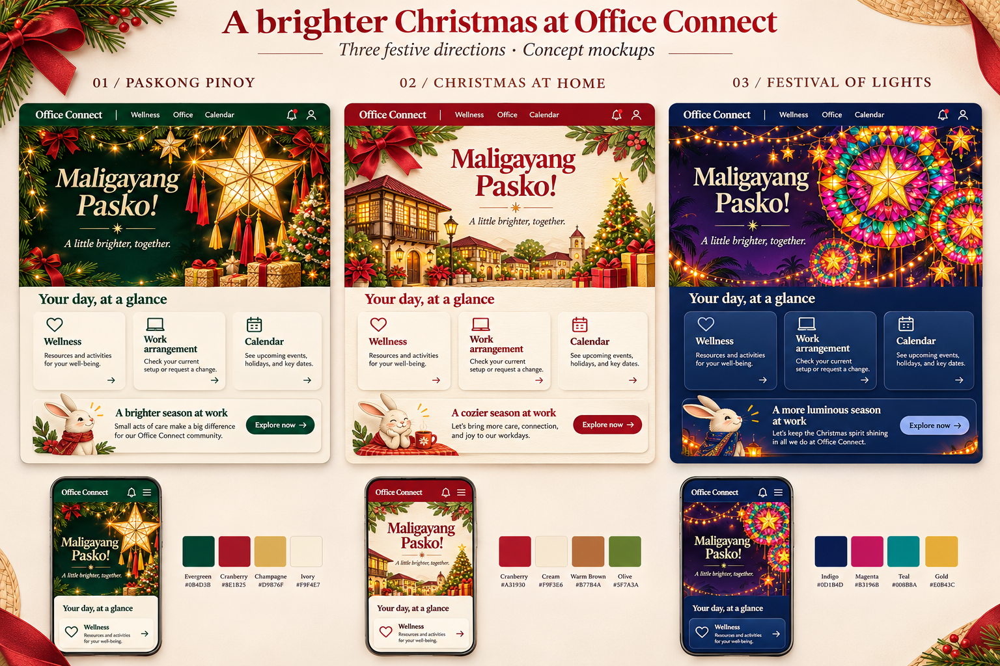

# Christmas replacement mockups — November 5, 2026

Design study for Office Connect. The request is for replacement mockups, not a
production theme change. Review branch: `design/christmas-replacement-mockups-2026-11-05`.

[Open the desktop and phone comparison board](comparison-board.png)

Implementation now exists on `feat/paskong-pinoy-theme`: [real screenshots and verification](IMPLEMENTATION.md). The original concept study below remains unchanged.

## Recommendation

**01 — Paskong Pinoy** is the recommended direction: luminous capiz-inspired
parols, midnight evergreen, cranberry ribbons and champagne highlights. Use a
single strong composition with believable light, material and depth. Keep the
work area ivory and legible. The existing theme's Filipino identity is valuable;
the replacement should give that identity much stronger visual expression.

**02 — Christmas at Home** uses warm ivory, cranberry typography and a layered
paper village inspired by Filipino houses. It is the lightest, most welcoming
option, with Christmas trees, gifts and illuminated windows establishing the
season even without a dark background.

**03 — Festival of Lights** uses navy/plum, jewel colours and intricate radial
lanterns inspired by Pampanga's giant lantern tradition. This is the most dramatic
night treatment and a possible alternate direction for dark appearance.

The comparison board is AI-generated original concept artwork. Its dashboard
content is illustrative, not live application data. It communicates art direction;
it is not evidence of implemented responsive behaviour or final pixel-perfect UI.

## Existing design reviewed

- `static/css/seasonal-celebrations.css` and `static/css/christmas-companions.css`.
- `docs/design/seasonal/integrated-christmas-desktop.png`.
- `docs/design/christmas-companions/desktop.png` (includes the newer companion stage).
- Existing seasonal and companion SVG artwork and implementation handoff.

The current palette is predominantly muted green and cream. The sparse geometric
tree, thin garlands and repetitive courtyard share similar visual weight. The
large companion stage also pushes useful work farther down the page. Proposed
improvements are richer focal artwork, selective saturated red/gold accents,
layered warm lighting and a more compact companion treatment. Moving the companion
is a proposed layout choice, not an already approved implementation decision.

## External references consulted

Retrieved November 5, 2026. These are inspiration and construction references;
no third-party photographs or artwork are bundled or copied into the concepts.

1. [Parol — Wikipedia](https://en.wikipedia.org/wiki/Parol): five-point star
   construction, capiz materials, decorative tails and halo variations inform
   direction 01. Its discussion of concentric Kapampangan lantern construction
   informs direction 03.
2. [Giant Lantern Festival — Wikipedia](https://en.wikipedia.org/wiki/Giant_Lantern_Festival):
   San Fernando's large illuminated lantern tradition supports the regional visual
   reference for direction 03. The concept is an interpretation, not a reproduction
   of a named artisan's lantern.
3. [How to Decorate a Christmas Tree — Balsam Hill](https://www.balsamhill.com/inspiration/how-to-decorate-a-christmas-tree):
   cohesive themes, branch fullness, lights placed at multiple depths, ribbons,
   and varied ornament sizes inform the material and lighting hierarchy.

Research was via retrieved web pages. Some additional publisher URLs returned
403/404/500 and were not relied on. No claim of an exhaustive design survey is made.

## Implementation handoff after direction selection

- Preserve existing Office Connect navigation, permissions, content and brand mark.
- Build decorative artwork as optimized original assets, with text rendered in HTML.
- Keep the festive hero around 300–360 px on desktop. On phones, retain a
  deliberately composed 120–160 px art region with the greeting above it; do not
  crop away all the parols or let decorations overlap text.
- Retain existing companion species, outfit preferences and explicit sound
  controls. The board's rabbit is a placeholder, not a new avatar asset.
- Keep working forms compact; concentrate spectacle on Home and the decorative
  page frame. Avoid placing ornaments behind fields, status labels or controls.
- Preserve artwork-off, reduced-motion, high-contrast and print behaviour. The
  default design should succeed without animation. No auto-playing sound.
- Derive light and dark variants of the selected direction rather than forcing
  different art directions onto users when they change colour mode.
- Verify text contrast, 320/390/768/1440 px layouts, enlarged text, keyboard use,
  form-state retention and existing appearance tests during implementation.

This study does not change application code, deploy a preview, or change production
appearance settings. Application tests and release gates are not claimed for it.
